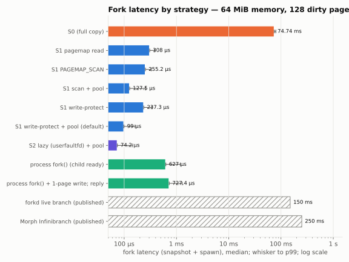
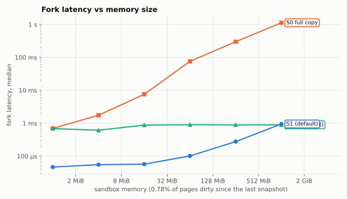
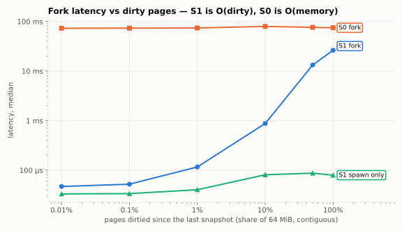
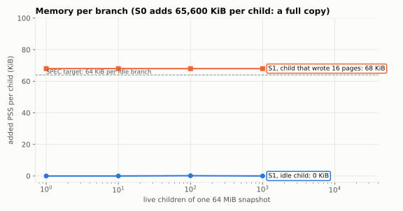
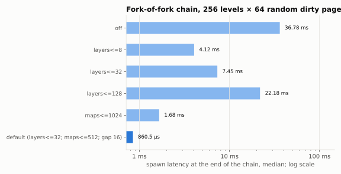
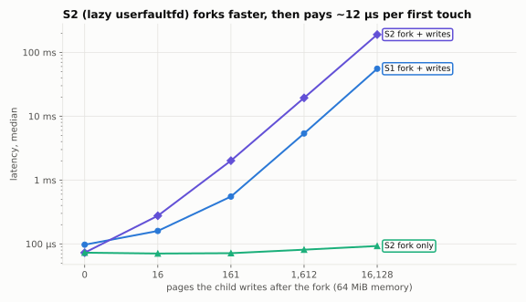
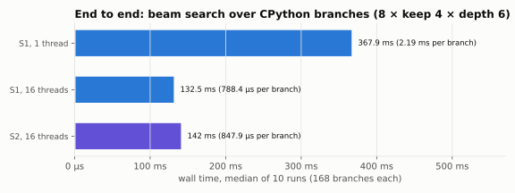

# forkasm benchmarks

All numbers come from one full run of `forkasm-cli bench-suite`, on
2026-11-08. The raw tables (Markdown and CSV, each headed by the
environment) are in [`bench-results/2026-11-08/`](bench-results/2026-11-08).
The charts are generated from those CSVs by
[`scripts/charts.py`](scripts/charts.py).

| | |
|---|---|
| CPU | AMD Ryzen 7 7735HS (8 cores / 16 threads), laptop |
| Kernel | Linux 7.0.0-38-generic, `vm.max_map_count` 1,048,576 |
| Wasmtime | 47.0.4 (Cranelift) |
| Rust | rustc 1.99.1, release build |
| forkasm | 0.1.0, default configuration unless stated |

**Method.**
- Every measurement is warmed up first. Tables show **median / p99**: over
  1,000 runs for the S1/S2 latency rows, and over ≥ 100 for S0 and the
  larger sizes (the CSVs give the exact counts).
- A fork is **snapshot + spawn**: the parent captures its state and one child
  is instantiated from it.
- "Dirty" pages are pages written since the parent's last snapshot.
- Memory is measured as **PSS** from `/proc/self/smaps_rollup`, because RSS
  double-counts shared pages.
- This is a laptop, not an isolated benchmark machine. Treat differences
  under ~10% as noise.

**Reproduce.**

```sh
guests/py/build.sh
cargo build --release -p forkasm-cli
target/release/forkasm-cli bench-suite guests/kv/target/wasm32-wasip1/release/kv.wasm \
    guests/py/out/py.wasm guests/py/out/lib bench-results/$(date +%F)    # ~3 min, ~3 GiB RAM
python3 scripts/charts.py bench-results/$(date +%F) docs/charts
```

## Against the targets (SPEC §1)

| Target | Result | |
|---|---|---|
| Fork latency, 64 MiB, < 1% pages dirty: **< 50 µs** | **99 µs** median (S1 default), 74 µs (S2) | **missed**, by ~2× |
| Extra memory per idle branch: **< 64 KiB** | **< 1 KiB** PSS, 8 VMAs | met (see the caveat under *Memory per branch*) |
| Fork-of-fork depth: **≥ 64** | 256-level chains benchmarked; property tests reach depth 134 | met |
| Concurrent live branches: **≥ 1,000** | 1,000 live children of a 64 MiB snapshot: 68 KiB PSS each after writing 16 pages | met |

With 1 dirty page, a fork takes **47 µs**; with 16, it already takes 52 µs.
At the 0.78% the headline uses, the snapshot copies 512 KiB (~58 µs). The
spawn costs ~35–40 µs whatever the snapshot holds: instantiation, a few
`mmap`s, and restoring globals. That spawn floor is what stands between
forkasm and the 50 µs target.

## Fork latency by strategy



64 MiB memory, 128 contiguous dirty pages (0.78%).

| strategy | iterations | snapshot | spawn | fork |
|---|---|---|---|---|
| S0 (full copy) | 100 | 48.31 ms / 52.38 ms | 26.27 ms / 28.62 ms | 74.74 ms / 79.67 ms |
| S1 pagemap read | 1000 | 274.4 µs / 341.7 µs | 32.3 µs / 51.8 µs | 308.0 µs / 385.4 µs |
| S1 PAGEMAP_SCAN | 1000 | 221.2 µs / 287.3 µs | 32.8 µs / 49.8 µs | 255.2 µs / 330.7 µs |
| S1 scan + pool | 1000 | 93.3 µs / 172.2 µs | 33.0 µs / 84.6 µs | 127.5 µs / 256.0 µs |
| S1 write-protect | 1000 | 196.8 µs / 286.5 µs | 40.1 µs / 72.8 µs | 237.3 µs / 341.9 µs |
| **S1 write-protect + pool (default)** | 1000 | **58.0 µs / 106.7 µs** | **40.4 µs / 78.0 µs** | **98.9 µs / 161.7 µs** |
| S2 lazy (userfaultfd) + pool | 1000 | 59.4 µs / 123.5 µs | 14.1 µs / 36.5 µs | 74.2 µs / 145.3 µs |
| process fork() (child ready) | 200 | – | – | 627.0 µs / 1.18 ms |
| process fork() + 1-page write, reply | 200 | – | – | 727.4 µs / 1.29 ms |

- **S1 default vs S0: 756× faster** at this size, and the gap grows with
  memory (see the next chart).
- **S1 vs process `fork()`: 6.3× faster.** `fork()` copies the page tables of
  the whole host process, which here holds just one 64 MiB sandbox. A real
  agent host holding many sandboxes would pay more.
- **Two optimisations account for most of the speed-up from scan-and-copy
  (255 µs).** A pre-allocated layer pool takes shmem page allocation off the
  fork path. Async write-protect tracking replaces the parent's remap. Each
  helps alone; together they bring the fork to 99 µs.
- **S2 has the fastest fork,** because spawn maps nothing. The cost moves to
  the child's first touch of each page; see *S1 vs S2* below.
- **The VM-level rows are published figures,** not measured here, and come
  from different hardware: forkd's live branch is ~150 ms and Morph
  Infinibranch is < 250 ms. They are reference points for scale, not a
  controlled comparison. The default S1 fork is ~1,500× below forkd's figure.

## Fork latency vs memory size



The dirty fraction is fixed at 0.78% of pages, so the dirty set grows with
memory.

| memory MiB | dirty pages | S0 fork | S1 snapshot | S1 spawn | S1 fork | process fork() |
|---|---|---|---|---|---|---|
| 1 | 1 | 698.4 µs / 1.14 ms | 12.6 µs / 25.1 µs | 33.8 µs / 48.1 µs | 46.6 µs / 73.0 µs | 686.7 µs / 1.26 ms |
| 4 | 5 | 1.75 ms / 3.04 ms | 21.1 µs / 36.9 µs | 33.7 µs / 56.1 µs | 55.0 µs / 95.8 µs | 611.1 µs / 1.12 ms |
| 16 | 29 | 7.58 ms / 14.80 ms | 22.3 µs / 38.0 µs | 34.1 µs / 51.2 µs | 57.0 µs / 91.3 µs | 880.0 µs / 1.51 ms |
| 64 | 125 | 75.82 ms / 81.98 ms | 59.2 µs / 97.4 µs | 41.2 µs / 78.0 µs | 101.4 µs / 146.7 µs | 900.0 µs / 1.55 ms |
| 256 | 509 | 299.73 ms / 310.39 ms | 223.9 µs / 392.2 µs | 51.4 µs / 153.3 µs | 276.8 µs / 492.9 µs | 889.8 µs / 1.72 ms |
| 1024 | 2042 | 1.12 s / 1.15 s | 892.7 µs / 1.18 ms | 53.9 µs / 92.0 µs | 947.4 µs / 1.28 ms | 893.9 µs / 1.54 ms |

- **S0 scales with memory size.**
- **S1's spawn barely moves** (34 → 54 µs over 1,000× more memory). Its
  snapshot scales with the dirty pages, not the size.
- **At 1 GiB, S1 roughly ties process `fork()`.** At that size, 0.78% dirty
  means copying 8 MiB per snapshot. S1 stays ahead whenever the dirty set is
  small in absolute terms.

## Fork latency vs dirty pages



64 MiB memory; the dirty pages are contiguous.

| dirty pages | dirty % | S0 fork | S1 snapshot | S1 spawn | S1 fork | S1 maps/child |
|---|---|---|---|---|---|---|
| 1 | 0.01 | 72.95 ms / 78.15 ms | 13.5 µs / 21.2 µs | 33.3 µs / 51.3 µs | 47.0 µs / 92.0 µs | 4 |
| 16 | 0.10 | 73.33 ms / 78.16 ms | 18.4 µs / 37.0 µs | 33.8 µs / 49.2 µs | 52.3 µs / 75.9 µs | 4 |
| 161 | 1.00 | 73.92 ms / 80.91 ms | 74.2 µs / 136.5 µs | 40.4 µs / 89.9 µs | 116.4 µs / 192.7 µs | 4 |
| 1612 | 10.00 | 79.30 ms / 89.66 ms | 794.4 µs / 1.27 ms | 81.0 µs / 133.0 µs | 876.2 µs / 1.37 ms | 4 |
| 8064 | 50.00 | 76.20 ms / 88.33 ms | 13.16 ms / 14.57 ms | 87.3 µs / 124.1 µs | 13.25 ms / 14.66 ms | 4 |
| 16128 | 100.00 | 74.67 ms / 77.56 ms | 26.20 ms / 28.29 ms | 79.4 µs / 124.4 µs | 26.28 ms / 28.36 ms | 4 |

- **S1's fork is O(dirty pages).** At 100% dirty it is still 2.8× faster
  than S0. Up to 10% dirty, the snapshot captures dirty pages at ~8 GB/s,
  including the scan.
- **Beyond ~10% dirty the snapshot slows down further** (50% costs 13 ms,
  where linear scaling from 10% would predict ~4 ms). The layer no longer
  fits in a pool slab and is written with `pwritev` into a fresh memfd.

## Memory per branch



N live children of one 64 MiB snapshot, measured as added PSS per child.

| strategy | N | dirty pages/child | PSS/child KiB | VMAs/child |
|---|---|---|---|---|
| S0 | 1 | 0 | 65600 | 2 |
| S0 | 10 | 0 | 65600 | 2 |
| S0 | 10 | 16 | 65600 | 2 |
| S1 | 1 | 0 | 0 | 8 |
| S1 | 1 | 16 | 68 | 8 |
| S1 | 100 | 0 | 0.2 | 8 |
| S1 | 1000 | 0 | 0 | 8 |
| S1 | 1000 | 16 | 68 | 8 |

- **An idle S1 child adds no measurable PSS.** Its memory is shared layer
  pages, and its Wasmtime store and instance fit in allocator memory that
  was already resident.
- **A child that writes 16 pages adds 68 KiB:** the 64 KiB it wrote, plus
  one stack page.
- **Caveat:** PSS does not count kernel memory. Page tables and VMA structs
  are excluded, and each S1 child costs 8 VMAs (8,000 for the 1,000-child
  run). So "< 1 KiB" is user memory only. Kernel overhead is on the order of
  a few KiB per child.

## Fork-of-fork depth and compaction



**Adversarial setup.** 256 levels of fork-of-fork on 64 MiB. Each level
dirties 64 *random* pages, snapshots, and continues in a fresh child.

| compaction | snapshot | spawn | merges | maps/child at end |
|---|---|---|---|---|
| off | 2.38 ms / 4.55 ms | 36.78 ms / 53.32 ms | 0 | 14023 |
| layers<=8 | 420.1 µs / 71.71 ms | 4.12 ms / 6.26 ms | 42 | 1217 |
| layers<=32 | 593.4 µs / 45.19 ms | 7.45 ms / 12.61 ms | 9 | 1506 |
| layers<=128 | 1.45 ms / 2.79 ms | 22.18 ms / 37.05 ms | 2 | 1 |
| maps<=1024 | 242.9 µs / 70.25 ms | 1.68 ms / 3.57 ms | 28 | 510 |
| **default (layers<=32, maps<=512, gap 16)** | **186.3 µs / 70.57 ms** | **860.5 µs / 1.79 ms** | 51 | 131 |

- **Without compaction**, a deep child needs 14k mappings, and spawn costs
  37 ms.
- **The default keeps chains bounded:** 131 mappings per child, and a spawn
  under 1 ms.
- **The p99 snapshot (~70 ms) is the honest cost of this workload.**
  Random pages across all of memory make each merge cover nearly everything,
  so a merge is a full 64 MiB copy.
- **Real workloads cluster their writes.** On CPython (300 levels of small
  statements, `forkasm-cli py-profile`), the default compaction gives a
  63 µs snapshot and a 367 µs spawn, with a p99 snapshot of ~1.3 ms. See
  NOTES.md, *Week 3*.

## S1 vs S2 (lazy userfaultfd)



64 MiB; the parent dirties 128 pages; the child then writes N pages.

| child writes | S1 fork | S1 fork + writes | S2 fork | S2 fork + writes |
|---|---|---|---|---|
| 0 | 97.1 µs / 141.8 µs | 97.1 µs / 141.8 µs | 72.8 µs / 149.9 µs | 72.9 µs / 149.9 µs |
| 16 | 96.2 µs / 157.4 µs | 159.5 µs / 239.7 µs | 70.6 µs / 130.5 µs | 275.6 µs / 427.2 µs |
| 161 | 93.4 µs / 129.5 µs | 550.9 µs / 746.5 µs | 71.5 µs / 164.3 µs | 2.01 ms / 2.66 ms |
| 1612 | 96.1 µs / 143.6 µs | 5.36 ms / 6.72 ms | 81.1 µs / 157.2 µs | 19.36 ms / 23.73 ms |
| 16128 | 113.8 µs / 213.1 µs | 55.38 ms / 58.95 ms | 92.7 µs / 178.9 µs | 189.74 ms / 208.65 ms |

- **S2 forks ~25 µs faster.**
- **It then pays ~12 µs per first touch.** That is a round trip through one
  userfaultfd handler thread, against ~3.4 µs for an S1 copy-on-write fault.
- **S2 only wins for children that touch almost nothing.** Otherwise S1
  stays the default. A multi-threaded handler, or `UFFDIO_COPY` of whole
  runs instead of single pages, would narrow the gap.

## End to end: beam search over CPython



**Workload.** The branch driver runs a beam search: branching 8, keep 4,
depth 6, for 168 branches in total. Each branch:
1. spawns from its parent's snapshot;
2. reseeds `random`;
3. sorts 2,000 random floats in CPython 3.12;
4. reports a score.

| strategy | threads | repeats | branches | wall | per branch | fork share |
|---|---|---|---|---|---|---|
| S1 | 1 | 10 | 168 | 367.94 ms / 373.99 ms | 2.19 ms | 1.0% snapshots |
| S1 | 16 | 10 | 168 | 132.50 ms / 136.41 ms | 788.4 µs | 3.9% snapshots |
| S2 | 16 | 10 | 168 | 142.00 ms / 144.98 ms | 847.9 µs | 1.8% snapshots |

- **Forking is a small share of the work:** 1–4% of wall time goes to
  snapshotting survivors. Spawning runs inside each branch.
- **Parallel scaling is 2.8× on 16 threads.** Each level is a short burst
  of 8–32 sub-millisecond branches. The likely limits, not yet profiled,
  are rayon's scheduling overhead and the process-wide `mmap_lock` that
  every spawn takes.

**Load and spawn costs for CPython** (19 MB module, `forkasm-cli
py-profile`):

| step | time |
|---|---|
| `Runtime::load`, cold (rewrite + Cranelift compile) | ~1.0 s |
| `Runtime::load`, with `Config::compile_cache` hit | ~90 ms |
| root spawn + `py_init` | ~22 ms |
| fork between statements: snapshot + spawn of an 8-way fan-out (demo) | 0.6 ms + 1.2 ms for all 8 |

## History

| date | change | S1 fork, 64 MiB / 128 dirty |
|---|---|---|
| 2026-10-11 | Week 1: pagemap scan + per-layer memfd + parent remap | 225 µs |
| 2026-10-11 | Layer pool + async write-protect tracking | 95 µs |
| 2026-11-08 | Full suite rerun (rustc 1.99, same code path) | 99 µs |
